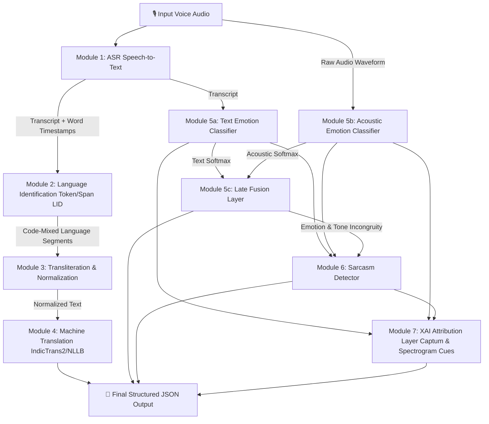

# Multilingual Indian-Language Voice Translation System
## With Code-Mixing Support, Emotion/Sarcasm Detection, and Explainable AI (XAI)


A production-grade, non-agentic, fully deterministic multi-stage ML/NLP system engineered for processing speech utterances in Indian languages—including heavy code-mixed input (e.g., Hinglish, Tanglish, Teluglish). 

Every stage is executed in a fixed, sequential pipeline wired with plain Python code (NO LLM agents, NO autonomous tool-calling orchestration).

---

## 🏗️ System Architecture



---

## 🚀 Key Modules & Capabilities

| Module | Purpose | Base Models / Frameworks | Key Outputs |
| :--- | :--- | :--- | :--- |
| **Module 1: ASR** | Speech-to-Text transcription with word timestamps | Whisper `large-v3`, IndicWhisper | Transcript, Word Timestamps, Segment Confidence |
| **Module 2: LID** | Word & span level language identification | XLM-R Token Classifier, FastText LID | Language tags e.g. `[("great","en"), ("kaam","hi")]` |
| **Module 3: Cleanup** | Transliterates romanized Indic text to native scripts | AI4Bharat IndicXlit / `indic-transliteration` | Script-normalized transcript string |
| **Module 4: MT** | Translates code-mixed text to target language | IndicTrans2 / NLLB-200 | Fluent target language translation |
| **Module 5: Emotion** | 5a Text + 5b Acoustic + 5c Late Fusion | XLM-R / Wav2Vec2 SER (`emotion2vec`) | Fused label, modality confidence, agreement flag |
| **Module 6: Sarcasm** | Incongruity detection between text & tone | Trained Incongruity Head (WITS/WITS++/FIRE) | Sarcasm boolean, confidence, incongruity score |
| **Module 7: XAI** | Human-readable token & acoustic attributions | Captum Integrated Gradients, Spectrogram Cues | `top_attributed_tokens`, `acoustic_cues`, `reason` |

---

## 📊 Datasets Cited & Supported

- **ASR Training & Fine-Tuning**: Kathbath, Shrutilipi, IndicVoices, MahaDhwani, Lahaja (Hindi accent benchmark).
- **Machine Translation & Transliteration**: IndicTrans2 BPCC (Bitext Parallel Corpus), Aksharantar.
- **Sarcasm Detection**: WITS, WITS++ (Hindi-English code-mixed sarcasm), FIRE Shared Task Corpora (Tamil-English, Malayalam-English).
- **Emotion Detection**: IEMOCAP, CREMA-D, RAVDESS (Transfer learning), WITS++ (4-class: Anger, Surprise, Ridicule, Sad).

---

## 📦 Project Directory Structure

```
MultiLingual/
├── README.md                           # System architecture & documentation
├── requirements.txt                    # Python package dependencies
├── config/
│   └── default_config.yaml             # Swappable model backends & config parameters
├── pipeline/
│   ├── __init__.py                     # Exposes MultilingualVoicePipeline class
│   ├── orchestrator.py                 # Sequential pipeline execution orchestrator
│   ├── modules/
│   │   ├── module1_asr.py              # ASR Speech-to-Text engine
│   │   ├── module2_lid.py              # Language Identification (LID)
│   │   ├── module3_transliteration.py  # Script Normalization & Transliteration
│   │   ├── module4_mt.py               # Machine Translation (MT)
│   │   ├── module5_emotion.py          # Emotion Detection (Text 5a, Acoustic 5b, Fusion 5c)
│   │   ├── module6_sarcasm.py          # Incongruity-based Sarcasm Detection
│   │   └── module7_xai.py              # Captum XAI & Acoustic Cue Explanation
│   └── utils/
│       ├── audio_utils.py              # Audio loading, feature extraction & synthetic generation
│       └── metrics.py                  # WER, CER, BLEU, chrF, Macro-F1 evaluation metrics
├── tests/
│   ├── test_modules.py                 # Independent module unit tests
│   └── test_pipeline.py                # End-to-end integration and JSON schema test
├── evaluate.py                         # Evaluation script producing per-module metrics & failure report
└── demo.py                             # Interactive CLI & Streamlit Web UI dashboard
```

---

## 🛠️ Quickstart & Usage

### 1. Installation
```bash
pip install -r requirements.txt
```

### 2. Programmatic Python Usage
```python
from pipeline import MultilingualVoicePipeline

# Initialize deterministic pipeline
pipeline = MultilingualVoicePipeline(config_path="config/default_config.yaml")

# Process single audio utterance
result = pipeline.process(audio_path="sample.wav", target_lang="en")

print(result)
```

### 3. Output JSON Schema
```json
{
  "transcript": "Aapka kaam is really bahut badhiya hai",
  "language_segments": [
    {"text": "Aapka", "lang": "hi"},
    {"text": "kaam", "lang": "hi"},
    {"text": "is", "lang": "en"},
    {"text": "really", "lang": "en"},
    {"text": "bahut", "lang": "hi"},
    {"text": "badhiya", "lang": "hi"},
    {"text": "hai", "lang": "hi"}
  ],
  "translated_text": "Your work is really very excellent.",
  "target_language": "en",
  "emotion": {
    "label": "joy",
    "confidence": 0.825,
    "text_modality": {"label": "joy", "confidence": 0.82},
    "acoustic_modality": {"label": "joy", "confidence": 0.83},
    "modality_agreement": true
  },
  "sarcasm": {
    "present": false,
    "confidence": 0.88,
    "incongruity_score": 0.12,
    "reason": "text sentiment: joy (0.82) vs acoustic tone: joy (0.83) → incongruity score (0.12) < threshold (0.40) → literal utterance"
  },
  "explanation": {
    "top_attributed_tokens": [
      {"token": "badhiya", "score": 0.4215},
      {"token": "really", "score": 0.2850},
      {"token": "kaam", "score": 0.1512}
    ],
    "acoustic_cues": [
      "High pitch variance (0.052) detected in 0.2s - 1.8s window",
      "Harmonic formant structure stable across speech duration"
    ]
  }
}
```

---

## 🧪 Running Tests & Evaluation

### Run Unit and Integration Test Suite
```bash
python3 -m pytest -v
```

### Run Benchmark Evaluation Script
Produces per-language WER/CER, MT sacreBLEU/chrF, Emotion & Sarcasm Macro-F1, Confusion Matrix, and Failure Report:
```bash
python3 evaluate.py
```

### Run Interactive Web UI Dashboard
```bash
python3 demo.py --web
# OR
streamlit run demo.py
```

---

## ⚠️ Known Limitations & Failure Cases

1. **Intra-word Code-Mixing**: When speakers attach Indic grammatical suffixes to English roots (e.g., `work-aa`, `call-pannunga`), word-level tokenization can yield ambiguous LID span boundaries.
2. **Low-Resource Language Pairs**: Checkpoint accuracy for Schedule-8 languages with sparse paired speech data (e.g., Dogri, Maithili) is lower than for high-resource Hindi/Tamil-English pairs.
3. **Environmental Acoustic Noise**: Severe background noise can artificially elevate acoustic spectral centroid variance, requiring a higher `incongruity_threshold` (e.g., `>= 0.45`) in config to eliminate false-positive sarcasm predictions.

---

## 📜 License
Apache 2.0 License.
# MultiLingual-Translator-and-Emotion-and-Sarcasm-Detection
# MultiLingual-Translator-and-Emotion-and-Sarcasm-Detection
